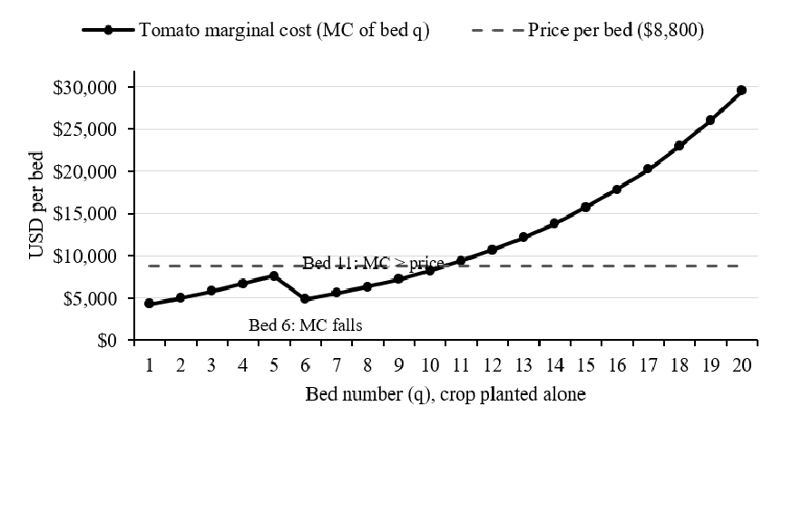
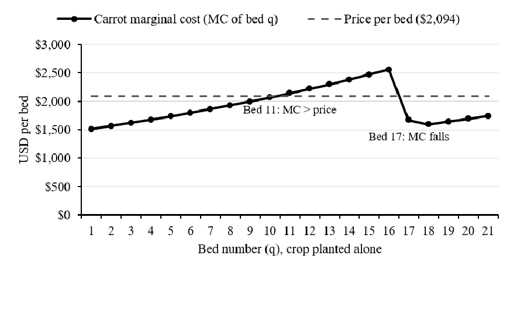

# Marginal Cost, Binding Limits, and the Tomato Cutoff on a 64-Bed Farm

## Where the Money Crop Stops

Tomatoes stop at ten beds. Under perfect competition, the farm accepts the market price, so the decision rule is to keep planting while price covers marginal cost. Tomatoes sell for $8,800 per bed (Marginal Analysis Model, Inputs B17); all cell references cite this Excel file, model.xlsx, by sheet and cell. The tenth bed costs $8,248.59 (Calculations D50), whereas the eleventh costs $9,390.72 (Calculations D51), which exceeds its revenue; the crossing therefore falls at bed 10 (Calculations B34), as Fig. 1 shows. The cause is the exponential labor term. Each bed raises labor per bed by 10 percent (Inputs B20), and ten beds already require 2,334 hours (Calculations B9). Hence, a crop priced above four times the carrot price receives half the carrot acreage.

*Fig. 1. Tomato marginal cost versus price, tomatoes planted alone. Data: Marginal Analysis Model, Calculations D41:D60; price from Inputs B17.*

## Which Constraints Bind

Neither the bed cap nor the labor cap binds at the optimum. The plan uses 60 of 64 beds (Optimization C13:C14) and 5,277 of 6,480 labor hours (Optimization C17; Calculations B15).

Relaxing either limit is worth nothing; the bed cap would have to fall below 60 before profit declined, and at 58 beds the loss is about $593. The binding constraints are the crop maximums, with carrots at 20 beds and mesclun at 30 (Inputs B21, B26). Relaxing the carrot maximum by one bed would add $352.49, because the twenty-first bed costs $1,741.51 against a $2,094 price (Calculations G61). A thirty-first mesclun bed would add about $246, by recalculation. A test of every whole-number allocation confirms 10/20/30 as optimal, so the failed second Solver run (Validation H44) reflects the solver, not the model.

## Falling Marginal Cost

Marginal cost does fall. Tomato marginal cost declines from $7,660.86 at bed 5 to $4,906.28 at bed 6 (Calculations D45:D46). Carrot cost falls to $1,670.90 at bed 17 (Calculations G56:G57; Fig. 2), and mesclun cost falls at bed 14 (Calculations J53:J54). The explanation lies in the accounting convention. The farmer’s first 720 hours are charged at $34.72 per hour and every later hour at $17.36 (Calculations B12:B13), so the cheaper rate applies once cumulative hours pass 720. The workbook labels this method inferred (Inputs A33). Labor hours themselves never decline; only their price does, which explains why the standalone mesclun crossing at bed 6 (Calculations D34) lies far below the 30 beds planted.

*Fig. 2. Carrot marginal cost versus price, carrots planted alone. Data: Marginal Analysis Model, Calculations G41:G61; price from Inputs B22.*

## Standalone Profit

Only tomatoes would be profitable on their own. Ten beds earn $88,000, less $8,800 in fertilizer and $53,027.23 in labor (Calculations B6, B8, C50), leaving $26,172.77 before the $20,000 fixed cost (Inputs B8). Twenty carrot beds yield $3,511.08 before fixed cost (Calculations C6, C8, F60), and thirty mesclun beds yield $8,077.81 (Calculations D6, D8, I70). Both lose money alone after fixed costs. The distinction carries limited weight because the fixed cost is shared and the farmer's $25,000 wage is paid once rather than three times. Together, the farm earns $42,761.66 (Optimization C19), and removing carrots or mesclun would reduce profit by about $16,000 and $20,600, so each crop justifies its place.

## Comparison With the Hypothesis

The Stage 1 hypothesis predicted 12 tomato beds, 20 carrot beds, and 30 mesclun beds (Perfect Competition Brief 1). The model returns 10, 20, and 30 (Optimization C10:C12), so carrots and mesclun matched, and tomatoes missed by two beds. The hypothesis set its own test: more than 15 tomato beds or fewer than 25 mesclun beds, and neither condition occurred, so the hypothesis survives. The mechanism, however, was misjudged. The hypothesis held that total labor hours would bind, yet 1,203 hours remain unused (Calculations E9, B15). Exponential labor cost did restrain tomatoes as argued, but the labor-hour limit never mattered.

